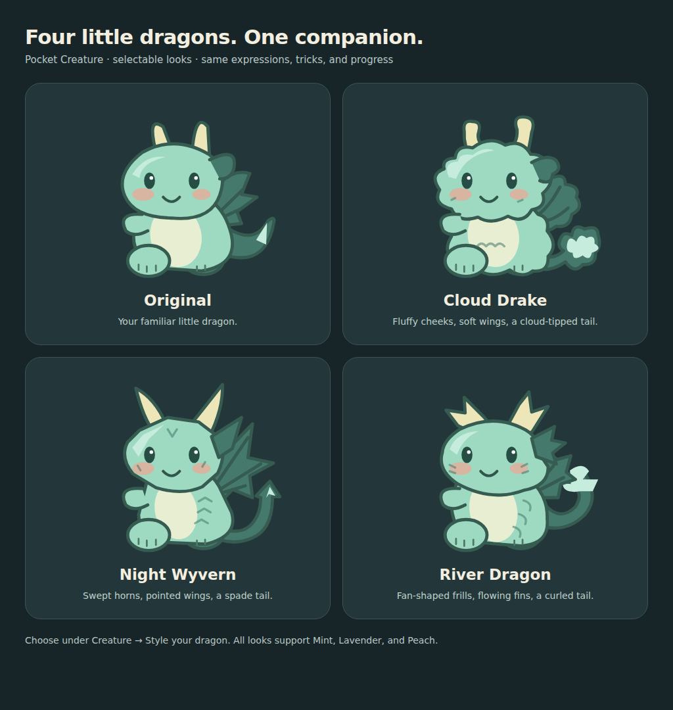
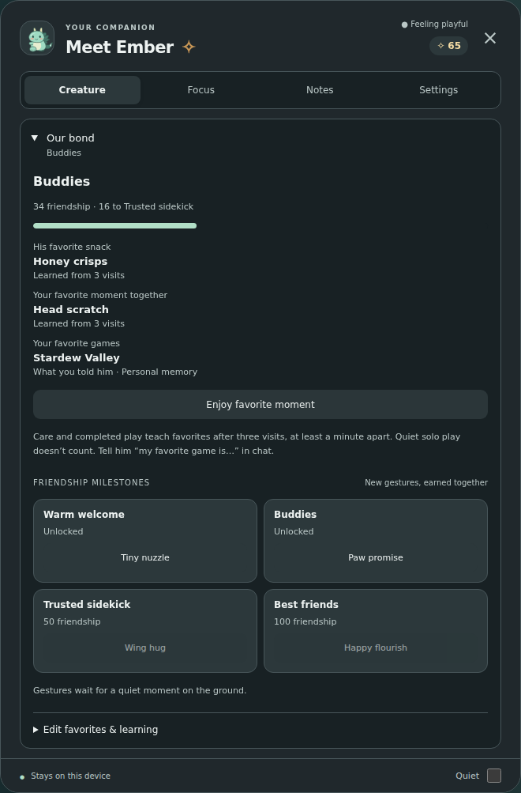

# Pocket Creature

A little company. A little curiosity. A tiny dragon for your Windows desktop.

**0.23.0 · public beta** · Windows 10/11 x64 · Optional local AI · MIT

[**Download the Windows app**](https://github.com/Woonnk/pocket-creature/releases/download/v0.23.0/Pocket-Creature-0.23.0-Windows.exe) · [Release notes](https://github.com/Woonnk/pocket-creature/releases/tag/v0.23.0) · [Setup guide](docs/guide.md) · [Report a bug](https://github.com/Woonnk/pocket-creature/issues/new/choose)


Meet your dragon, give him a home, teach him tricks, and let him keep you company while you work or play. Built-in care, movement, timers and reactions work without a model. Optional Ollama adds short conversations and observations; optional Windows or Kokoro voices let him speak.

## What's new since 0.15.1

| Feature | What it adds |
| --- | --- |
| Four dragon looks | Original, Cloud Drake, Night Wyvern and River Dragon. Free switching keeps your personality and progress. |
| Smoother motion | Moving paws, breathing, wings, tail, blinks, soft landings and eased pose transitions. |
| Better reaction timing | Current app/file context settles before a reaction. Typing and conversations take priority; stale observations are discarded. |
| Voice expressions | Mouth movement follows supported voice timing, with small phrase gestures and personality posture. Optional local chirps start off. |
| Favorites and friendship | Repeated care and completed play teach favorites. Friendship unlocks four gestures. Review, edit or forget what he learns. |
| More quiet company | Facial expressions, paw offers, toy visits, trick practice, small adventures and an honest attention badge. |
| Everyday helpers | Local reminders, focus sessions, opt-in startup, save backups and clearer connection status. |



## Start in a minute

1. [Download Pocket-Creature-0.23.0-Windows.exe](https://github.com/Woonnk/pocket-creature/releases/download/v0.23.0/Pocket-Creature-0.23.0-Windows.exe).
2. Quit an older copy from its tray, then launch the new app. Your existing desktop save stays in the same location.
3. Open **Companion** or the tray controls. Click the dragon to talk, drag to move him, or right-click for controls.
4. Try **Creature → Style your dragon**, **Little moments**, or **Our bond**. Change themes under **Settings → General**.

The download is a portable Windows app. Keep it in a permanent folder before enabling launch at startup. The executable is unsigned. This is a beta before stable 1.0; the [verification record](QA.md) distinguishes automated checks from direct Windows acceptance.

| Shortcut | Action |
| --- | --- |
| Ctrl + Shift + P | Show or hide the dragon |
| Ctrl + Shift + G | Recover the overlay over a game |
| Ctrl + Shift + F9 | Hold to talk, after enabling push-to-talk; F8/F10 are selectable |
| Ctrl + Shift + M | Stop spoken output |
| Escape | Cancel current voice activity or close the open controls |

## A companion with favorites

Open **Creature → Our bond** to see what he's learned and how your friendship is growing.

- Choose **Berry bites, Honey crisps, or Moon cookies** under **Edit favorites & learning → Next little snack**, then use **Little snack**.
- Three visits at least a minute apart teach a favorite snack or activity. Care, completed fetch catches, and completed manual moments count; interrupted moments and solo play do not.
- He recognizes his favorite snack, can repeat a favorite moment, and leans toward eligible favorites during existing quiet routines.
- Pin a favorite yourself, choose **No favorite**, pause learning, or forget care/play favorites. Forgetting also pauses learning until you turn it back on.
- Tell him “my favorite game is Stardew Valley” in chat, or edit favorite games here. Games share Personal memory and respect its switch. Editing or forgetting games also clears recent conversation.

Existing friendship counts toward **Tiny nuzzle (10), Paw promise (25), Wing hug (50), and Happy flourish (100)**. Older milestones unlock quietly. New milestone notices leave the current conversation intact. Try gestures when he's settled; they stay in place, earn no extra rewards, and pause for games or reduced motion.



## Make him your own

Choose four personalities, three colors, hats, and five readable themes. Give him a movable bed and toy basket; earn coins through care, fetch and focus, then unlock decorations permanently. Home routines bring stretches, naps or quiet toy visits. Games tuck the home away and keep the dragon in a chosen corner.

**Creature → Trick school** teaches Wave, Bow, Spin and Hop through three completed practices. **Little moments** offers scratches, paws, toy visits and settling nearby. Motion level, Wandering, silent habits, reduced motion and Quiet let you tune how much company you want.

## Optional local AI and voice

**Ollama:** leave it running on the same PC with a model installed. **Settings → Local AI** discovers installed models and reconnects automatically. Ollama and models are installed separately; the companion needs no account or API key. Built-in behavior remains available without Ollama.

**Windows voice:** open **Settings → Voice**, refresh installed voices, select one, test it, and enable Spoken replies. Push-to-talk is a separate opt-in. Hold the button or shortcut, speak, then release; uncertain recognition can be reviewed before sending. Games mute speech by default.

**Kokoro:** optional natural local speech needs a separate service. Follow the [Kokoro setup guide](docs/guide.md#natural-local-voices-optional). Stop or repeat the last reply without another AI request.

Mouth movement follows Kokoro WAV playback or supported native voice events; word timing is an approximate fallback. Voices without timing keep a still mouth. Games and reduced motion keep voice animation still. **Voice → Dragon expressions & sounds** holds the gesture and optional chirp controls.

## What he notices

Supported foreground apps, transient window titles, typing counts and idle time can trigger reactions. Connected project folders allow supported saved text/code files to be sampled when their editor filename is recognized. The attention badge distinguishes **filename only** from **read text sample**.

Screen awareness is **off by default** and requires a local vision model. Eligible observations can use occasional snapshots of the selected monitor. This is not continuous video or game telemetry. He does not infer favorite games or victories from titles. Borderless/windowed games may be needed for overlay visibility.

Typed characters are not read. Raw file samples and snapshots are not saved, though conversations can quote observations. Personal facts come from clear messages or edits. AI uses a fixed localhost Ollama endpoint and cannot run commands or click your PC. Observation, memory, voice, Quiet and reduced-motion controls remain independent. See the [full guide](docs/guide.md) and [security/privacy notes](SECURITY.md).

## Run from source

Use Node.js 24 and npm:

```sh
npm ci
npm run demo
```

Open the localhost URL printed by the demo. On Windows, use `npm start` for the desktop app. The [standalone browser playground](https://github.com/Woonnk/pocket-creature/releases/download/v0.23.0/Pocket-Creature-Playground.html) previews the renderer with separate browser progress; PC sensing, Windows recognition and local services need the desktop app.

```sh
npm test
npx playwright install chromium
npm run test:browser
npm run dist:win
npm run check:release
```

The recorded 0.23 verification includes **153 logic tests and 23 browser suites**, plus package and extracted-portable checks. GitHub Actions runs Windows/Linux logic checks, browser regressions, Windows helper compilation and Windows packaging. Check [Actions](https://github.com/Woonnk/pocket-creature/actions) for the published commit's results. Packaging does not establish native microphone, mixed-DPI or exclusive-fullscreen compatibility; open checks are in [QA.md](QA.md).

Screenshots show the actual browser renderer with sample progress; the bond frame is expanded to show the whole disclosure. They are not a native Windows acceptance test.

## Project links

- [Roadmap](ROADMAP.md) · [Changelog](CHANGELOG.md) · [Release notes](RELEASE_NOTES.md)
- [Contribution guide](CONTRIBUTING.md) · [Release process](docs/RELEASING.md)
- [MIT license](LICENSE) · [Third-party runtime notices](THIRD_PARTY_NOTICES.md)
