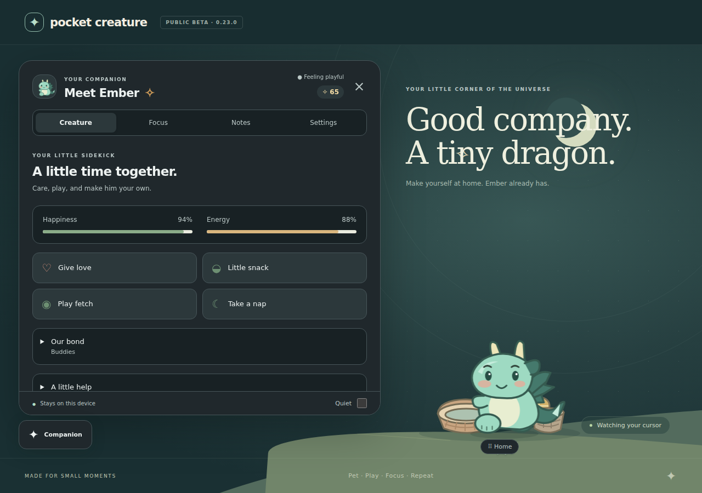
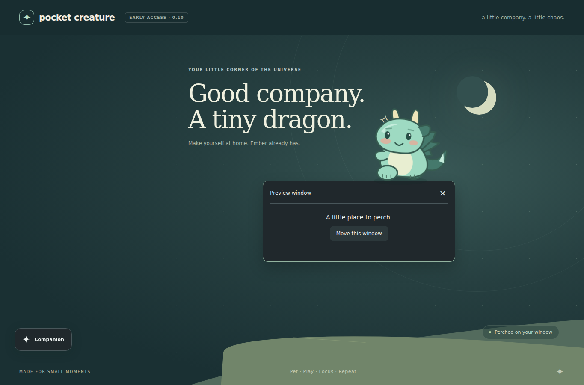
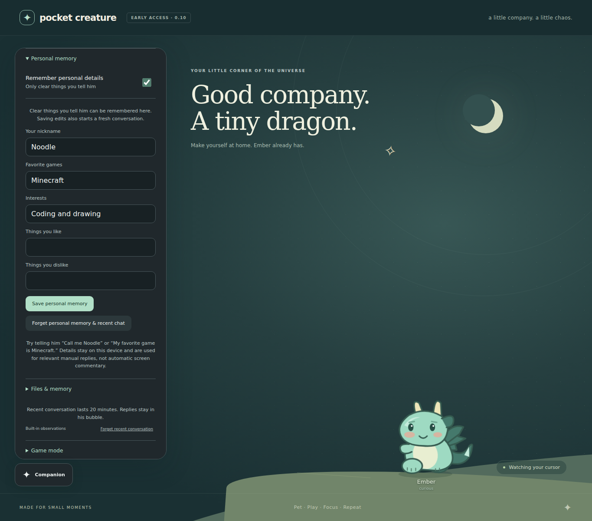

# Pocket Creature

A tiny dragon that lives on your Windows desktop: a little company, a little curiosity, and occasional snack opinions.

**Current build: 0.10.0 · public beta.** Windows desktop behavior is still being verified before the stable 1.0 release. See [QA.md](QA.md) for tested behavior and remaining native checks.



## What he does

- Pet, feed, drag, toss, play fetch, and customize your dragon.
- Notice supported apps, typing activity, editor filenames, and idle time.
- Sit on a restored window’s top edge and follow it as it moves.
- Talk through short speech bubbles, with optional local Ollama replies.
- Keep recent conversations connected across app switches.
- Remember clear personal details you tell him, with editable/forgettable memory.
- Stretch, groom, and settle down with personality-specific silent habits.
- Keep a small, quiet corner during games; recover the overlay with Ctrl + Shift + G.
- Use five readable themes, four personalities, focus sessions, reminders, and a notebook.

### Window perching and personal memory

Browser playground previews are shown below. Native Windows perching and live-model personalization still require direct PC verification.




## Try it

**Windows 10/11 x64:** download [Pocket-Creature-0.10.0-Windows.exe](https://github.com/Woonnk/pocket-creature/releases/download/v0.10.0/Pocket-Creature-0.10.0-Windows.exe) from the [0.10 beta release](https://github.com/Woonnk/pocket-creature/releases/tag/v0.10.0) and launch it. Quit an older copy from its tray first. Your local save stays in the same location. Use **Companion** or the tray for controls; click the creature for a message, drag to move, or right-click for controls. Ctrl + Shift + P shows/hides the creature. The executable is unsigned.

**Browser playground:** download and open [Pocket-Creature-Playground.html](https://github.com/Woonnk/pocket-creature/releases/download/v0.10.0/Pocket-Creature-Playground.html), or run the demo from source. It has simulated window perching and built-in file observations; PC-wide sensing and Ollama calls require the desktop app.

**Optional Ollama:** start Ollama on this PC and install a local model. Settings discovers installed models and reconnects automatically. Screen awareness requires a vision model and is off by default. No account or API key is required by the companion.

## Run from source

Use Node.js 24 and npm:

```sh
npm ci
npm run demo
```

Open the localhost URL printed by the demo. For the Windows desktop app, use `npm start` instead. More setup, controls, privacy details, and troubleshooting are in [the full guide](docs/guide.md).

## Develop and test

```sh
npm test
npx playwright install chromium
npm run test:browser
npm run dist:win
npm run check:release
```

The browser suite starts/stops its own local server. [CONTRIBUTING.md](CONTRIBUTING.md) explains Linux browser dependencies and development conventions. GitHub Actions covers Windows/Linux logic checks, browser regressions, C# helper compilation, and Windows package artifacts. Check the repository’s Actions tab for actual run results; prepared workflows alone do not establish native compatibility.

## Privacy and limits

Activity uses transient window titles/geometry, coarse app categories, idle time, and typing counts. Typed characters are not read. Text samples and screenshots are not saved; conversation may quote observations. Personal facts come from your messages or edits, never screenshots. Only manual replies receive personal memory. AI uses the fixed localhost Ollama endpoint.

Native geometry, mixed-DPI behavior, fullscreen games, and live-model accuracy remain subject to the checks in [QA.md](QA.md). Borderless/windowed games may be needed for visibility. A model can misunderstand a scene. Window perching needs enough room above a restored window on the overlay’s selected monitor; maximized/fullscreen windows and games take priority over perching.

## Project information

- [Roadmap](ROADMAP.md) and [changelog](CHANGELOG.md)
- [Release notes](RELEASE_NOTES.md) and [Release process and 1.0 preparation](docs/RELEASING.md)
- [Security/privacy reporting](SECURITY.md)
- [MIT license](LICENSE) and [third-party runtime notices](THIRD_PARTY_NOTICES.md)
